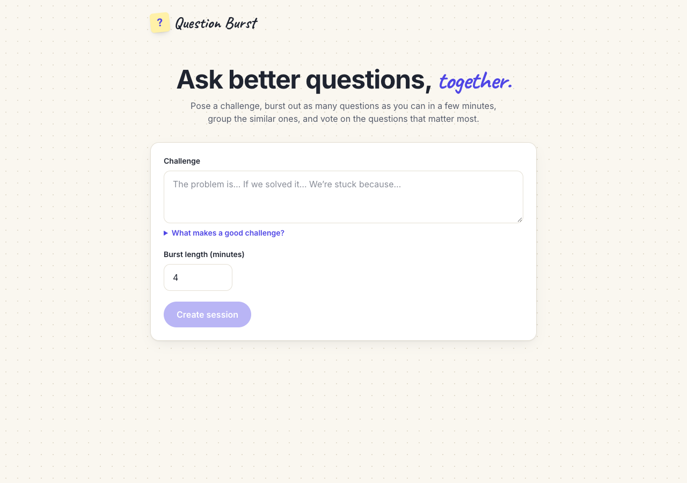
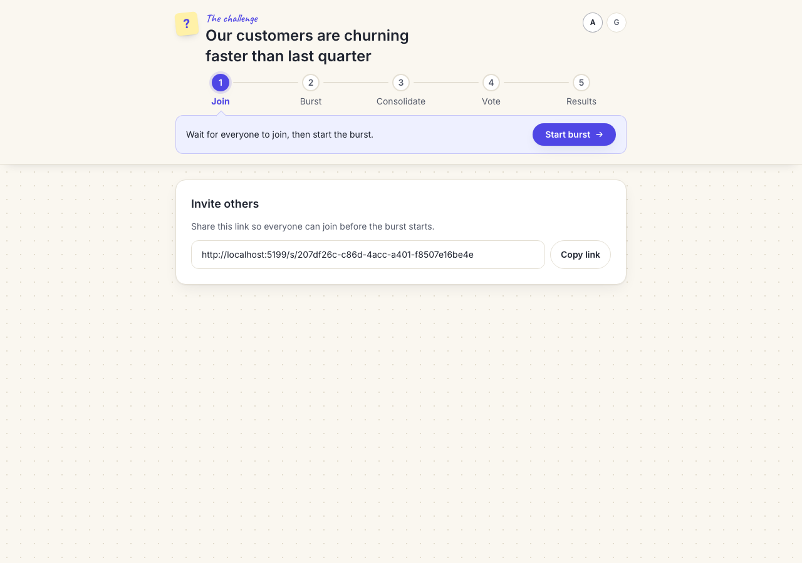
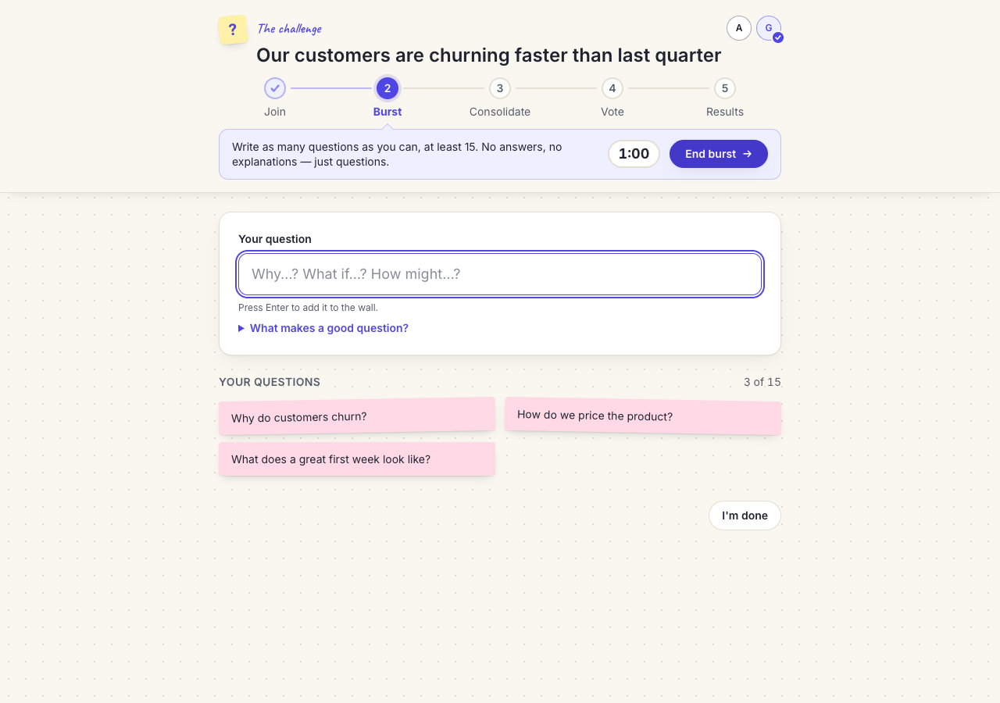
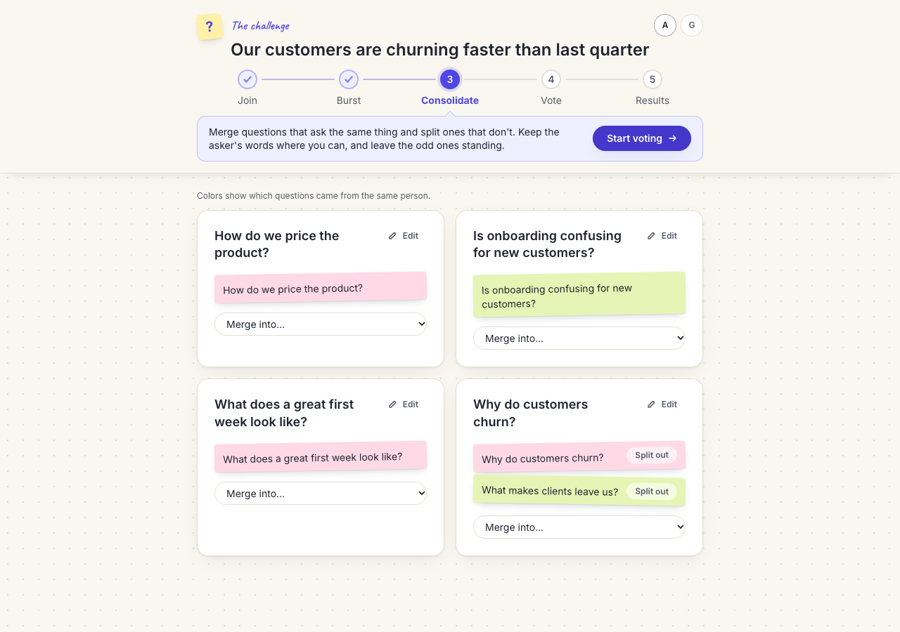
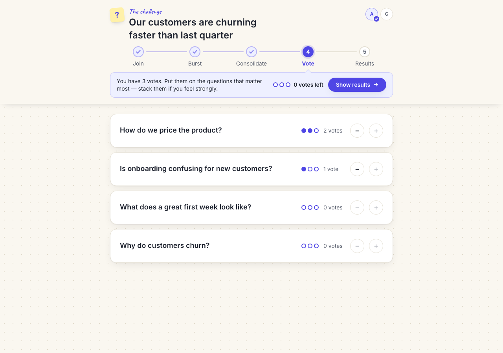
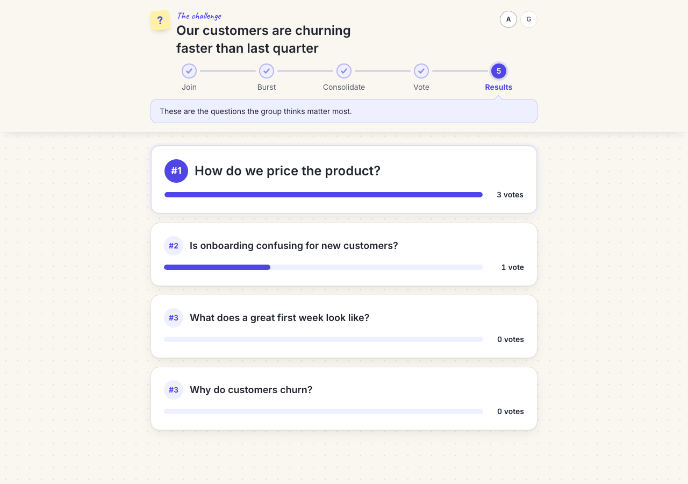
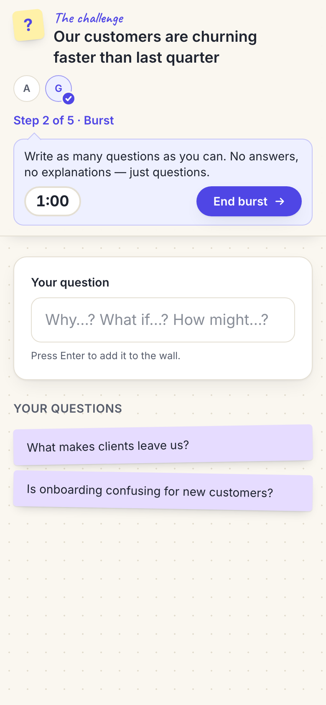

# Question Burst

A small collaborative web app inspired by Hal Gregersen's Question Burst practice. Each participant writes questions privately against a shared timer. The group then consolidates similar questions and dot-votes on the ones that matter most.

This is a personal prototype that runs locally. Planning artifacts live in `docs/plans/2026-10-20-question-burst-app/`.

## How it works

A sticky header keeps the challenge, the five steps and each person's status in view. The current step's callout says what to do now and holds the button that moves everyone to the next step.

**1. Create a session.** Describe the challenge in a few sentences: the problem, what would change if it were solved, and why you're stuck. Write it as a statement, not a question, so it doesn't steer the questions. Then pick a burst length (4 minutes by default).



**2. Join.** Share the link. Everyone joins with a display name and shows up as an initial in the header.



**3. Burst.** Everyone writes as many questions as they can against a shared countdown. You only see your own questions, so nobody anchors on anyone else's. A check on someone's initial means they've finished.



**4. Consolidate.** Claude groups questions that ask the same thing. Anyone can merge groups, split a question out, or reword a group's label. Authors stay anonymous; each note's color marks which questions came from the same person, without saying who.



**5. Vote.** Each person gets 3 dot votes and can stack them. Nobody sees anyone else's votes until results.



**6. Results.** Groups are ranked by votes, and tied groups share a rank. The results stay at the session link.



It works on phones too:



## Setup

```sh
npm install
cp .env.example .env   # required; then fill in ANTHROPIC_API_KEY
```

The server will not start without `ANTHROPIC_API_KEY` in `.env`.

## Scripts

| Command | What it does |
|---|---|
| `bin/dev` | Runs the Vite client (http://localhost:5173) and the API/WebSocket server (port 3001) together |
| `bin/test` | Runs the Vitest suite; pass a path to narrow it, e.g. `bin/test server/session` |
| `bin/typecheck` | Runs `tsc --noEmit` across `src`, `server` and `shared` |
| `bin/screenshots` | Runs a scripted two-person session in Chrome and saves the README screenshots to `docs/screenshots/` (or a folder you pass) |

`bin/screenshots` starts its own server on ports 3002 and 5199 with a throwaway database, so it doesn't touch a running `bin/dev`. It needs Google Chrome (set `CHROME_PATH` if it isn't in `/Applications`) and the `ANTHROPIC_API_KEY` in `.env`, because grouping calls Claude. Override the ports with `SCREENSHOT_SERVER_PORT` and `SCREENSHOT_CLIENT_PORT`.

## Configuration

| Variable | Default | Purpose |
|---|---|---|
| `PORT` | `3001` | Server port (Vite proxies `/api` and `/ws` to it) |
| `DATABASE_PATH` | `data/question-burst.db` | SQLite file holding sessions; `data/` is gitignored |
| `ANTHROPIC_API_KEY` | none (required) | Anthropic API key used to group similar questions |

`ANTHROPIC_API_KEY` must be an Anthropic API key from your organization's account. Keep it in `.env`, which is gitignored, and never commit it. Question text is sent only to Anthropic, and only to group similar questions.

## Demo locally

1. Run `bin/dev` and open http://localhost:5173.
2. Create a session with a challenge.
3. Open the session link in a second browser or a private window, and join under a different name.

Sessions are saved to SQLite, so they survive a server restart.

## Related Documents

- [Decisions](docs/plans/2026-10-20-question-burst-app/decisions.md)
- [Research](docs/plans/2026-10-20-question-burst-app/research.md)
- [Structure](docs/plans/2026-10-20-question-burst-app/structure.md)
- [Plan](docs/plans/2026-10-20-question-burst-app/plan.md)
